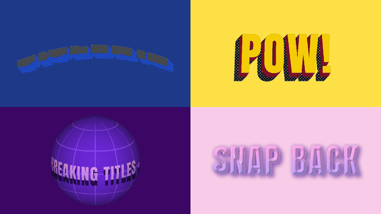
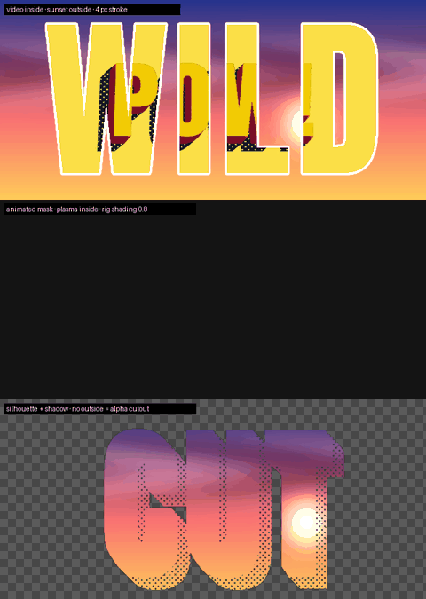
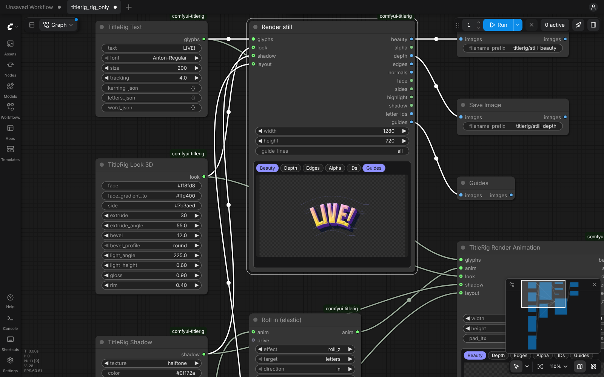
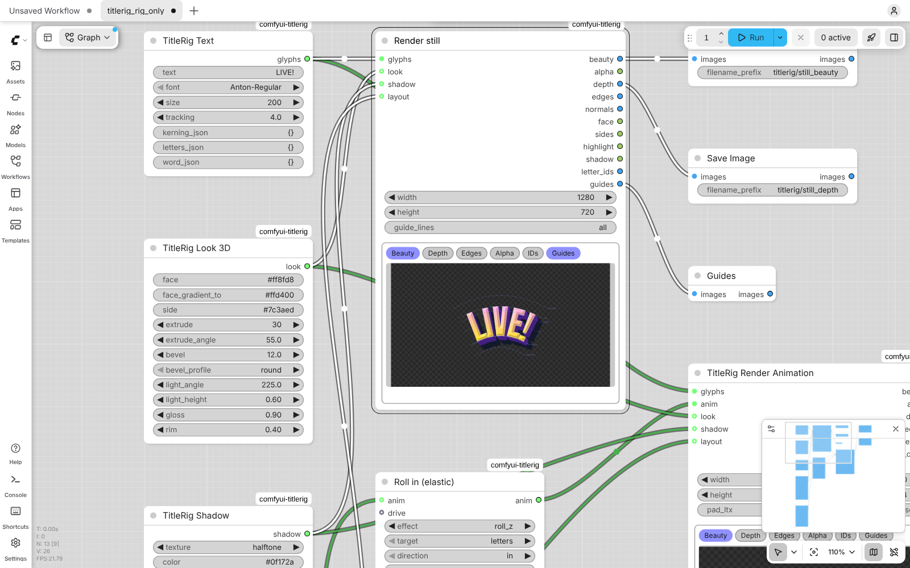

# TitleRig



**AI can't spell. So we gave it a rig.**

TitleRig is an open-source ComfyUI node pack that renders exact, animated 3D title text — extrusion, bevel, lighting and *textured shadows* (halftone, stripes, checker, noise, pixel, gradient) — and outputs every layer as its own connector. Feed the depth and edge passes to Flux or LTX-2 and the AI paints the material while the letters stay spelled right.

> Built for Comfy's *Open Source Higgsfield* challenge (Oct 2026).

## Nodes

| Node | What it does |
| --- | --- |
| **TitleRig Text** | text, font, size, tracking, per-pair kerning, per-letter overrides |
| **TitleRig Look 3D** | face colour/gradient, extrusion, bevel, key light, gloss, rim |
| **TitleRig Shadow** | angle, length, softness, textures: solid · halftone · stripes · checker · noise · pixel · gradient |
| **TitleRig Layout** | flat, **arc** (bend or custom bezier), **ticker** / **sphere** / **cube** wraps, **bulge**, perspective **tilt X/Y** + fov, **vanishing-point** extrusion, **flag** wave |
| **TitleRig Render** | one frame, every pass below; `guide_lines` = all · none · e.g. `baseline,mid` |
| **TitleRig Animate** | one track; chain several. Effects below, per letter or whole word, stagger + order, easing |
| **TitleRig Audio React** | AUDIO → beats / loudness / spectrum curve for Animate's `drive` input |
| **TitleRig Render Animation** | frames → IMAGE batches (beauty, alpha, depth, edges, letter_ids) + frame_count + fps + face / shadow masks |
| **TitleRig Style Preset** | 15 bright presets → prompts for FLUX.2-dev / FLUX 3 / LTX-2.3 (per the super-skills), a matching Look + Shadow, and settings JSON |
| **TitleRig Magnet** | a moving magnet (or second word) that attracts / repels letters: strength, range, lag, spring, squash & stretch, audio drive |
| **TitleRig SVG Export** | the rig traced to a layered SVG: shadow shapes, extrusion tones, one path per letter |
| **TitleRig Cutout** | an image or video **inside** the letters and another **outside**, masked by the rig per frame: mask from faces · faces + extrusion · silhouette + shadow; fit cover / contain / stretch; grow, feather, outline stroke, the rig's shading on top |
| **TitleRig Spell-Lock** | snaps AI frames back to the rig's exact silhouette (warp-snap + spill / hole repair, no OCR) and reports drift |

### Animate

- **Effects:** flip X · spin Y · roll Z · pop · drop · slide · squash · shake · extrude · light · tilt X/Y · bend · flag wave · shadow length / angle / opacity / softness
- **Easings:** linear · in · out · in_out · sine · expo · back · elastic · bounce · spring · steps
- **Orders:** forward · reverse · center_out · edges_in · random. **Directions:** in · out · loop
- **letters:** `all`, `0,2,5-7` (character indices) or `word:2`. With target `word`, a selection moves as one rigid group.
- **influence:** a 0–4 dial on how hard the track pushes.
- **Free transform:** `skew_x`, `skew_y`, `taper_x` (keystone; negative flares), `taper_y`, and `corner_pin` (`corners_json`: 4 corner offsets). Set it per letter in `letters_json`, per word in `word_json`, or on any group, and animate it like any other effect, sound included.

### Audio React (the hero)

AUDIO in (numpy only, no extra deps) → onsets by band spectral flux + peak-relative loudness → attack/release → one value per video frame.

- **band:** bass · mids · highs · full. Route each word or letter group to its own band.
- **mode:** beats · envelope · beats+envelope · **spectrum** (the letters become an EQ: lows left, highs right)
- **sensitivity · attack · release · start · max_seconds**
- In Animate, **response = trigger** makes every hit replay the track's easing (a kick lands, then bounces). **retrigger** = restart · finish (keeps bounces tidy on busy music) · layer.

## Outputs

| Connector | Type | Use |
| --- | --- | --- |
| beauty | IMAGE | finished rig render |
| alpha | MASK | title silhouette for compositing |
| depth | IMAGE | Flux depth models · LTX-2 Depth IC-LoRA |
| edges | IMAGE | Canny control (Flux · LTX-2 Canny IC-LoRA) |
| normals | IMAGE | relighting / material nodes |
| face · sides | MASK | style front faces and extrusion walls separately |
| highlight | MASK | glints, bloom, light sweeps |
| shadow | MASK | the textured shadow alone |
| letter_ids | IMAGE | one flat colour per letter |
| guides | IMAGE | dashed baseline / x-height / cap / ascender / descender |

## Install

Install the requirements into **ComfyUI's own Python**, not your system Python. A bare `pip` usually points at the system Python. Installing there leaves ComfyUI without the packages and can break other tools on your machine.

**ComfyUI Desktop** (macOS / Windows; the base folder is usually `~/Documents/ComfyUI`):

```bash
cd ~/Documents/ComfyUI/custom_nodes
git clone https://github.com/Cozy-Art/comfyui-titlerig
cd ..
.venv/bin/python -m pip install -r custom_nodes/comfyui-titlerig/requirements.txt
```

On Windows the last line is `.venv\Scripts\python -m pip install -r custom_nodes\comfyui-titlerig\requirements.txt`.

**Windows portable:**

```bash
cd ComfyUI_windows_portable
git clone https://github.com/Cozy-Art/comfyui-titlerig ComfyUI/custom_nodes/comfyui-titlerig
python_embeded\python.exe -m pip install -r ComfyUI/custom_nodes/comfyui-titlerig/requirements.txt
```

**Manual install** (a git clone of ComfyUI): activate the venv or conda env you start ComfyUI with, then:

```bash
cd ComfyUI/custom_nodes
git clone https://github.com/Cozy-Art/comfyui-titlerig
python -m pip install -r comfyui-titlerig/requirements.txt
```

ComfyUI Manager also installs the requirements into the right environment when you install from a git URL.

Restart ComfyUI. Then:
- The 13 nodes appear under **TitleRig**, and the live preview widget loads from `web/`.
- The workflows appear under **Templates → Extensions → comfyui-titlerig**.
- On first load, TitleRig copies its example beat track into `ComfyUI/input/`, so the audio template runs straight away. It never overwrites a file you already have.

The renderer is CPU-only, so the rig itself needs no GPU. It works with numpy 1.26 or 2.x. OpenCV is pinned below 4.12, because 4.12 and later force numpy 2.

If your environment already has `opencv-python` (non-headless) from another node pack, TitleRig works with it too, and you can leave it as it is.

**Check the install:** open **Templates → comfyui-titlerig → titlerig_rig_only** and press **Run**. It needs no models and writes a still and an animation to `output/titlerig/`. The LTX-2 and FLUX templates need model files first; see [`workflows/README.md`](workflows/README.md) or [`docs/BUILD_NIGHT.md`](docs/BUILD_NIGHT.md).

## Try it without ComfyUI

The MP4 and GIF demos need [ffmpeg](https://ffmpeg.org/) on your PATH (`brew install ffmpeg` on a Mac).

```bash
pip install -r requirements.txt pytest
python examples/contact_sheet.py   # stills + layout sheet → examples/out/*.png
python examples/animate_demo.py    # effect grid → examples/out/animate_grid.gif
python examples/audio_demo.py      # audio-reactive clips (+ MP4 with sound if ffmpeg is installed)
python examples/free_transform_demo.py  # skew / taper / corner pin sheet + sound-driven clip
python examples/hero_clips.py      # the four demo clips + hero.gif → docs/media/
python examples/build_demo.py --fast  # the 75 s demo video (docs/demo/SCRIPT.md)
python -m pytest -q
```

## Workflows

| Workflow | Kind | What it makes |
| --- | --- | --- |
| `example_workflows/titlerig_rig_only.json` | open, no models (CPU) | rig stills and passes |
| `example_workflows/titlerig_audio_react.json` | open, no models (CPU) | an audio-reactive title clip with sound |
| `example_workflows/titlerig_cutout.json` | open, no models (CPU) | letters pop in with an image inside and a colour outside (swap either for Load Video) |
| `example_workflows/titlerig_ltx2_animated.json` | **open weights** | Audio React → rig depth frames → LTX-2 + Depth Control IC-LoRA → Spell-Lock → MP4 with your track |
| `example_workflows/titlerig_ltx2_scene.json` | **open weights** | **the title rendered into your own image:** your image is frame 0, the rig's letters pop in and dance to the track, your prompt says what they're made of (fur, grass, ice…), and your image is restored everywhere except the letters and their shadow |
| `example_workflows/titlerig_ltx2_duo.json` | **open weights** | two layers, two materials: TITLERIG flies in and dances to the beat (fur), ON CLOUD NINE streams in under it while a beat-driven magnet knocks its letters (clouds); one LTX-2 pass per layer, each with its own prompt, cut back together with the rig's alpha |
| `example_workflows/titlerig_flux_still.json` | **open weights** | rig depth → FLUX.1 Depth [dev] → Spell-Lock → PNG + alpha cutout |
| `example_workflows/titlerig_flux2_still.json` | **open weights** | rig depth as a reference → FLUX.2-dev → Spell-Lock → PNG + alpha cutout |
| `workflows/bonus/titlerig_flux3.json` | API (paid) | rig beauty as image 1 → FLUX 3 → Spell-Lock |
| `workflows/bonus/titlerig_recraft_vector.json` | API (paid) | Recraft vectorize + Recraft V4 vector, next to TitleRig's free SVG export |

**Open them from ComfyUI's Templates menu → Extensions → comfyui-titlerig**, or drag a `.json` onto the canvas. The open-weights workflows are the contest entry. The `bonus/` API workflows are kept apart and are never part of it. `workflows/README.md` lists every model file with its Hugging Face link, target folder and licence. The AI workflows use only core ComfyUI nodes plus TitleRig (ComfyUI 0.43+).

## Demos (rig only, rendered on CPU)

`python examples/hero_clips.py` renders these into `docs/media/`. Each one is also saved as an MP4; the Ben-Day clip has sound.

| | |
| --- | --- |
|  |  |
| **Chrome Slam:** letters flip in one after another and land with a back-ease | **Ben-Day Pop:** kicks pop the letters and throw the halftone shadow; hats make them hop |
|  |  |
| **Sphere wrap:** a ticker on a spinning, tilted globe (seamless loop) | **Magnet:** a magnet word sweeps through; the letters repel, squash and spring back |

### Cutout text

`python examples/cutout_demo.py`



### Live preview on the canvas

Render and Render Animation get a preview widget: pass chips, guides and a frame scrubber. It follows ComfyUI's dark and light palettes.

| Dark | Light |
| --- | --- |
|  |  |

## Fonts

Only SIL Open Font License fonts are bundled (`fonts/`, licences alongside). Bring your own `.ttf`/`.otf` by path.

## Credits

- **LTX-2** and the Depth Control IC-LoRA by [Lightricks](https://huggingface.co/Lightricks) (open weights, LTX-2 Community License).
- **FLUX.1 Depth [dev]** and **FLUX.2 [dev]** by [Black Forest Labs](https://huggingface.co/black-forest-labs) (FLUX.1 [dev] and FLUX.2 [dev] Non-Commercial Licenses).
- **Gemma 3** text encoder by Google, as used by LTX-2. **Mistral Small** text encoder for FLUX.2.
- **FLUX 3** (BFL) and **Recraft V4** (Recraft) are paid APIs, used only by the bonus workflows through ComfyUI's partner nodes.
- **ComfyUI** and its official templates, the source of the LTX-2 and FLUX wiring and sampler settings.
- Prompts follow the **[super-skills](https://github.com/Cozy-Art/super-skills)** prompting skills by Jason Cozy (flux-2-prompts, flux-3-image-prompts, ltx-2-3-prompts, recraft-v4-prompts).
- Fonts: **Anton** (Vernon Adams) and **Shrikhand** (Jonny Pinhorn), SIL Open Font License.

## License

MIT © 2026 Jason Cozy
